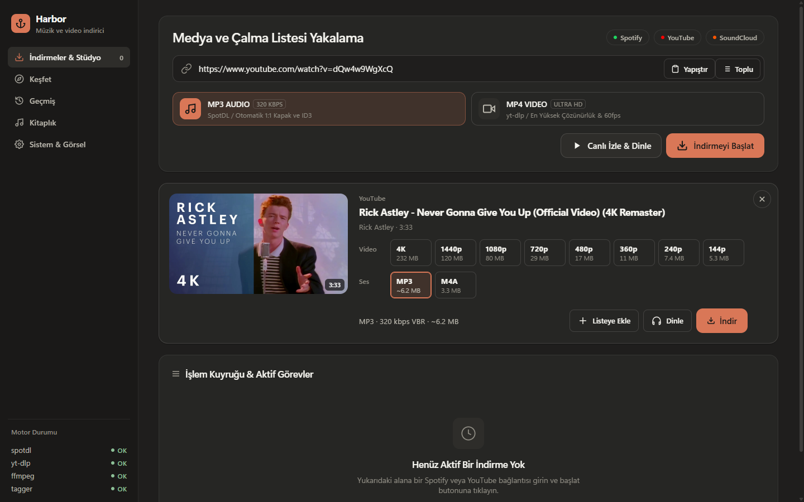
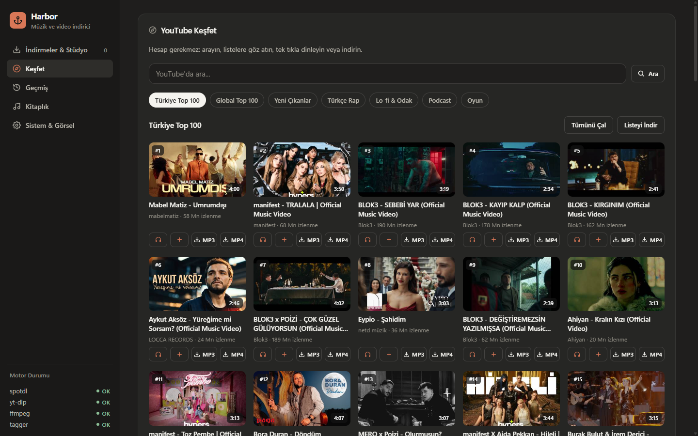
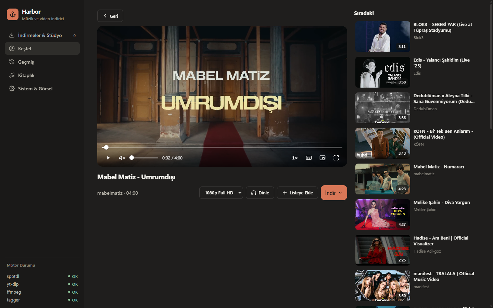
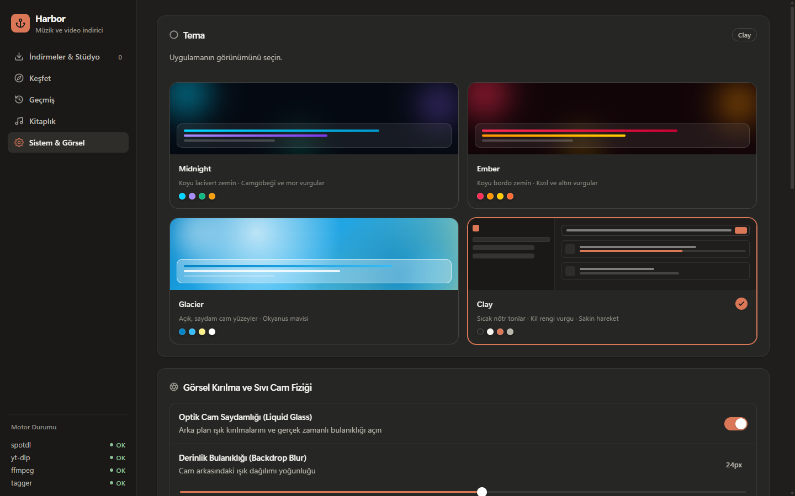

<div align="center">


# Harbor

**A desktop app to find, play and download music and video.**
Paste a link from YouTube, Spotify, SoundCloud or Apple Music, pick the quality, and keep it.


**English** · [Türkçe](README.md)

</div>



## What it does

Harbor is a front end for [yt-dlp](https://github.com/yt-dlp/yt-dlp) and [spotDL](https://github.com/spotDL/spotify-downloader), built to feel like a native music app rather than a command-line wrapper.

- **Paste and preview.** A pasted link turns into a preview card at once (no Enter). Every resolution is listed with its real file size, so a 1080p video isn't silently downloaded as a 700 MB 4K file.
- **Music with proper tags.** MP3 (320 kbps) or M4A, with title, artist, album and a square cover embedded so they show up correctly in Windows Explorer, Apple Music and phones.
- **Playlists and albums.** Download a whole playlist, or pick the tracks you want. Long lists ask before starting.
- **Watch and listen without downloading.** A YouTube-style watch page with suggestions, subtitles (including auto-translated ones), playback speed and dubbed audio tracks. A Spotify-style player bar keeps playing while you browse.
- **Smart queue.** Starting a single song fills the queue with similar songs (radio), instead of more copies of the same search.
- **Explore without an account.** Turkey and global top 100, new releases and genre lists, plus search.
- **Your own library.** Create playlists that mix music and video, import playlists from YouTube, Spotify, SoundCloud or Apple Music, or bring in local music from M3U/M3U8/PLS files, iTunes XML or a folder. Imported playlists keep their own cover and description from the platform, and a progress bar shows how far a long import has got. Give any playlist your own cover picture (PNG, JPEG, WebP, HEIC and more) and a description.
- **History.** Every download with its cover, length and source; re-download or open its folder in one click.
- **Keeps itself up to date.** Harbor checks for a new version on start, installs it and restarts by itself; no trips to GitHub for a new installer. yt-dlp is updated in the background too, since sites change often.
- **Battery saver.** On battery (or always) it turns off blur effects and animations, starts videos at 720p with hardware-decoded H.264 and runs one download at a time. On the Midnight theme, idle CPU drops from 75% of a core to 0.5%.
- **Four themes** (Clay, Midnight, Ember, Glacier), Turkish and English UI, smooth view transitions, and full `prefers-reduced-motion` support.

| Explore | Watch page |
|---|---|
|  |  |



## Install

1. Download `Harbor-Setup-<version>.exe` from [Releases](../../releases) and run it.
   The installer isn't code-signed, so Windows SmartScreen may warn the first time: choose **More info → Run anyway**.
2. Nothing else to install. Python, yt-dlp, spotDL and ffmpeg come inside the installer.
   On first launch a short **"Getting Harbor ready"** screen checks the components and, when online, updates yt-dlp to the latest release; then the app opens.

## Build from source

Requires Node.js 20+ and (only to build the engine) Python 3.12.

```powershell
npm install
npm run build:engine   # vendor/: the Python engine (PyInstaller) + ffmpeg, once
npm run dev            # development: watch mode, the app restarts when main-process code changes
npm start              # build once and run
npm run dist           # create the Windows installer in release/
```

Without `vendor/`, the app uses yt-dlp, spotdl and ffmpeg installed on the system.

`npm run build:icon` regenerates the icon set from `build/icon.svg`.

## How it's built

```
src/
├── main/                      Electron main process (Node.js)
│   ├── main.ts                window, single-instance lock, app lifecycle
│   ├── ipcHandlers.ts         typed IPC API, input validation
│   └── services/
│       ├── DownloadManager    download queue with concurrency, yt-dlp / spotDL processes, tagging
│       ├── ProbeService       link preview: qualities and real file sizes
│       ├── StreamManager      stream resolution, audio tracks, subtitles
│       ├── CatalogService     playlists, albums, search, related videos
│       ├── LibraryService     user playlists and imports
│       ├── LocalImport        M3U / PLS / iTunes XML / folder import
│       └── UpdateService      background yt-dlp updates
├── preload/                   contextBridge: the only door between the UI and Node
├── renderer/                  UI (TypeScript + CSS, no framework), bundled with esbuild
└── shared/                    types and URL helpers used by both sides
engine/
├── harbor_engine.py           the bundled Python engine: yt-dlp, spotdl, tagger, scan subcommands
└── requirements.lock.txt      pinned versions of every package in the engine
scripts/
├── build-engine.js            builds the engine with PyInstaller, downloads ffmpeg and checks its checksum
├── tagger.py                  ID3/MP4 tags and cover art (mutagen + Pillow)
├── scan_media.py              reads tags and covers of local music in bulk
└── spotdl_fast.py             runs spotDL with faster Spotify lookups
```

A few decisions worth mentioning:

- **Security:** the window runs with `contextIsolation`, `sandbox` and a strict Content Security Policy. The UI has no Node access; every action goes through a small, typed IPC surface whose inputs are validated in the main process.
- **Robust process handling:** every download runs in its own temp folder, output paths come from yt-dlp's own `--print-to-file` instead of parsing console text, and cancelling kills the whole process tree (yt-dlp → ffmpeg).
- **Nothing to install:** Python, yt-dlp, spotDL, mutagen and Pillow are frozen into one engine with PyInstaller; an LGPL ffmpeg build ships next to it. Because sites change often, the engine prefers a newer yt-dlp the app downloads, which is verified against the official SHA-256 list and test-run before it is used.
- **Speed:** spotDL's Spotify client re-downloaded about 75 web-player scripts for every track. `spotdl_fast.py` patches that in-process (parallel fetch + reuse) without modifying installed packages and falls back to the original code if anything differs, cutting a single-track download from ~34 s to ~22 s.
- **Motion:** tab changes use the View Transitions API; clicking a thumbnail morphs it into the player; selection indicators use spring physics (Motion). Everything falls back to instant changes under reduced motion.

## Disclaimer

Harbor is a personal project. Download only content you have the right to download, and follow the terms of service of the sites you use.

## License

Harbor's code is [MIT](LICENSE). The engine and ffmpeg shipped with the installer keep their own licenses (GPL-3.0+ and LGPL-2.1+); see [THIRD_PARTY_NOTICES.md](THIRD_PARTY_NOTICES.md).
