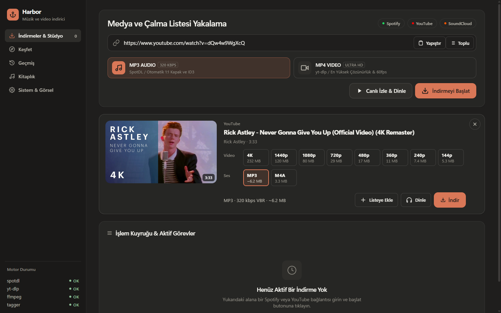
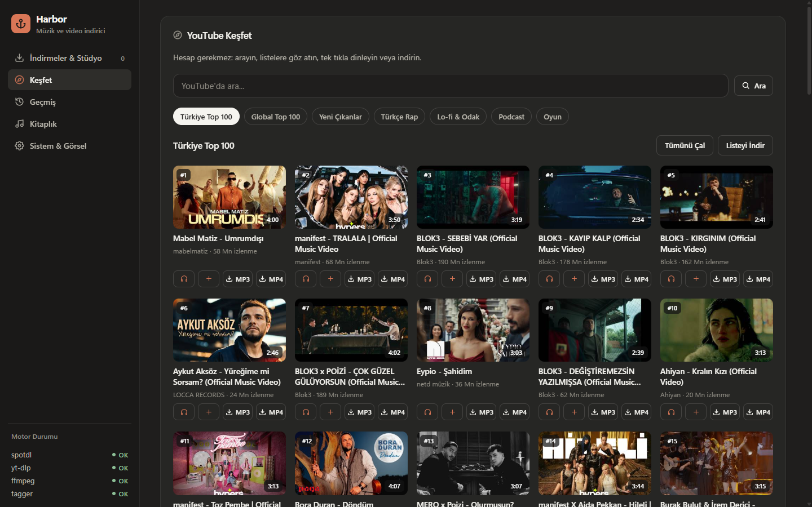
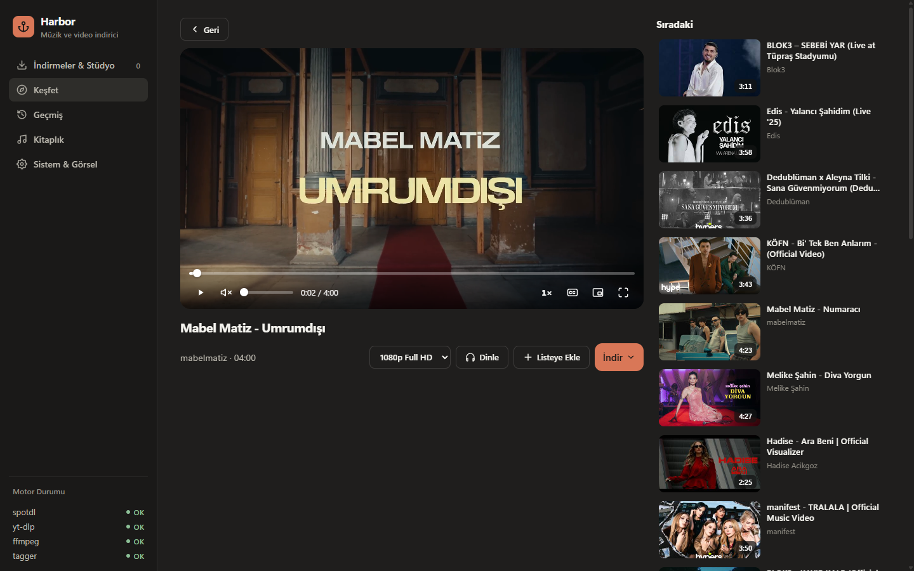
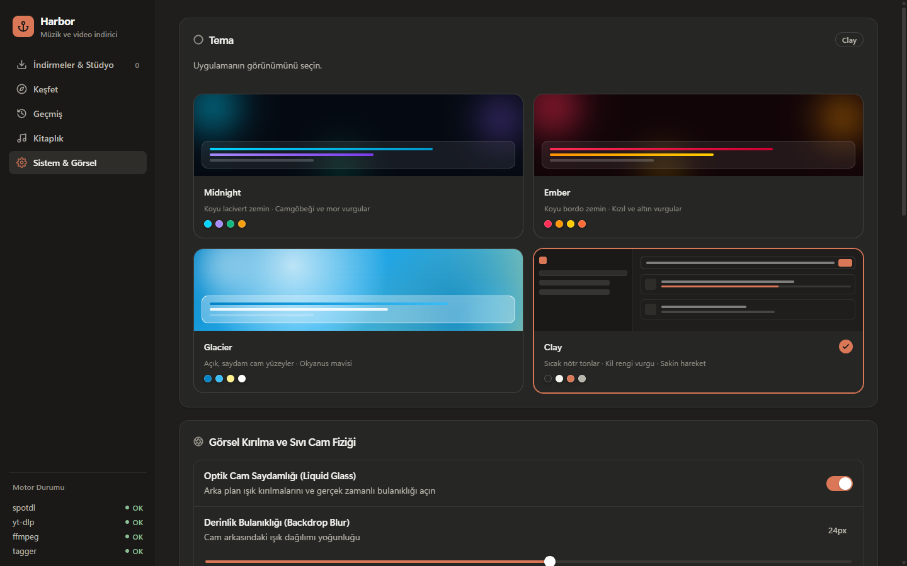

<div align="center">


# Harbor

**Müzik ve video bulmak, dinlemek ve indirmek için bir masaüstü uygulaması.**
YouTube, Spotify, SoundCloud veya Apple Music bağlantısını yapıştır, kaliteyi seç, sende kalsın.


**Türkçe** · [English](README.en.md)

</div>



## Ne yapar

Harbor, [yt-dlp](https://github.com/yt-dlp/yt-dlp) ve [spotDL](https://github.com/spotDL/spotify-downloader) için bir arayüz. Amaç bir komut satırı sarmalayıcısı değil, gerçek bir müzik uygulaması gibi hissettirmesi.

- **Yapıştır ve önizle.** Yapıştırılan bağlantı, Enter'a basmadan önizleme kartına dönüşür. Her çözünürlük gerçek dosya boyutuyla listelenir; 1080p istediğin bir video sessizce 700 MB'lık 4K olarak inmez.
- **Etiketleri düzgün müzik.** 320 kbps MP3 veya M4A. Başlık, sanatçı, albüm ve kare kapak dosyaya gömülür; Windows Gezgini'nde, Apple Music'te ve telefonda doğru görünür.
- **Çalma listeleri ve albümler.** Listenin tamamını indir ya da istediğin şarkıları seç. Uzun listeler başlamadan önce onay ister.
- **İndirmeden izle ve dinle.** Önerilerin olduğu YouTube tarzı bir izleme sayfası; altyazı (otomatik çevirili olanlar dahil), oynatma hızı ve farklı dillerde seslendirme. Spotify tarzı oynatıcı çubuğu sen gezinirken çalmaya devam eder.
- **Akıllı çalma sırası.** Tek bir şarkı başlatınca sıra, aynı aramanın kopyalarıyla değil benzer şarkılarla dolar (radyo).
- **Hesapsız keşfet.** Türkiye ve Dünya Top 100, yeni çıkanlar, tür listeleri ve arama.
- **Kendi kitaplığın.** Müzik ve videoyu karıştıran listeler oluştur; YouTube, Spotify, SoundCloud veya Apple Music listelerini içe aktar ya da yerel müziklerini M3U/M3U8/PLS dosyası, iTunes XML veya klasörden ekle. İçe aktarılan liste, varsa platformdaki kendi kapağı ve açıklamasıyla gelir; uzun listelerde ilerleme çubuğu kaç şarkının okunduğunu gösterir. Her listeye kendi kapak resmini (PNG, JPEG, WebP, HEIC ve diğerleri) ve açıklamasını ekleyebilirsin.
- **Geçmiş.** Her indirme kapağı, süresi ve kaynağıyla; tek tıkla yeniden indir veya klasörünü aç.
- **Kendini güncel tutar.** Harbor açılışta yeni sürümü denetler, indirip kurar ve kendiliğinden yeniden başlar; GitHub'a gidip exe indirmen gerekmez. Siteler sık değiştiği için yt-dlp da arka planda güncellenir.
- **Pil tasarrufu.** Pildeyken (ya da her zaman) bulanıklık efektlerini ve animasyonları kapatır, videoları 720p ve donanımla çözülen H.264 ile başlatır, aynı anda tek indirme yapar. Midnight temasında boştaki işlemci kullanımı tek çekirdeğin %75'inden %0,5'ine iner.
- **Dört tema** (Clay, Midnight, Ember, Glacier), Türkçe ve İngilizce arayüz, akıcı sayfa geçişleri ve `prefers-reduced-motion` (animasyonları azalt) desteği.

| Keşfet | İzleme sayfası |
|---|---|
|  |  |



## Kurulum

1. [Releases](../../releases) sayfasından `Harbor-Setup-<sürüm>.exe` dosyasını indirip çalıştır.
   Kurulum dosyası dijital olarak imzalı olmadığı için Windows SmartScreen ilk seferde uyarabilir: **Ek bilgi → Yine de çalıştır**.
2. Başka hiçbir şey kurman gerekmez. Python, yt-dlp, spotDL ve ffmpeg kurulum dosyasının içinde gelir.
   İlk açılışta kısa bir **"Harbor hazırlanıyor"** ekranı bileşenleri doğrular ve internet varsa yt-dlp'yi en yeni sürüme günceller; bitince uygulama açılır.

## Kaynaktan derleme

Node.js 20+ ve (yalnızca motoru derlemek için) Python 3.12 gerekir.

```powershell
npm install
npm run build:engine   # vendor/: Python motoru (PyInstaller) + ffmpeg, bir kez
npm run dev            # geliştirme: izleme modu, ana süreç kodu değişince uygulama yeniden başlar
npm start              # bir kez derle ve çalıştır
npm run dist           # release/ klasörüne Windows kurulum dosyasını oluştur
```

`vendor/` yoksa uygulama sistemde kurulu yt-dlp, spotdl ve ffmpeg'i kullanır.

`npm run build:icon`, ikon setini `build/icon.svg` dosyasından yeniden üretir.

## Nasıl yapıldı

```
src/
├── main/                      Electron ana süreç (Node.js)
│   ├── main.ts                pencere, tek örnek kilidi, uygulama yaşam döngüsü
│   ├── ipcHandlers.ts         tipli IPC API, girdi doğrulama
│   └── services/
│       ├── DownloadManager    eşzamanlılık sınırlı indirme kuyruğu, yt-dlp / spotDL süreçleri, etiketleme
│       ├── ProbeService       bağlantı önizlemesi: kaliteler ve gerçek dosya boyutları
│       ├── StreamManager      akış çözümleme, ses parçaları, altyazılar
│       ├── CatalogService     çalma listeleri, albümler, arama, ilgili videolar
│       ├── LibraryService     kullanıcı listeleri ve içe aktarma
│       ├── LocalImport        M3U / PLS / iTunes XML / klasör içe aktarma
│       └── UpdateService      arka planda yt-dlp güncellemeleri
├── preload/                   contextBridge: arayüz ile Node arasındaki tek kapı
├── renderer/                  arayüz (TypeScript + CSS, framework yok), esbuild ile paketlenir
└── shared/                    iki tarafın da kullandığı tipler ve URL yardımcıları
engine/
├── harbor_engine.py           paketlenmiş Python motoru: yt-dlp, spotdl, tagger, scan alt komutları
└── requirements.lock.txt      motordaki tüm paketlerin sabitlenmiş sürümleri
scripts/
├── build-engine.js            motoru PyInstaller ile derler, ffmpeg'i indirip sağlama toplamıyla doğrular
├── tagger.py                  ID3/MP4 etiketleri ve kapak (mutagen + Pillow)
├── scan_media.py              yerel müziklerin etiket ve kapaklarını toplu okur
└── spotdl_fast.py             spotDL'ı daha hızlı Spotify sorgularıyla çalıştırır
```

Öne çıkan birkaç karar:

- **Güvenlik:** Pencere `contextIsolation`, `sandbox` ve sıkı bir İçerik Güvenlik Politikası (CSP) ile çalışır. Arayüzün Node erişimi yoktur; her işlem küçük, tipli bir IPC yüzeyinden geçer ve girdiler ana süreçte doğrulanır.
- **Sağlam süreç yönetimi:** Her indirme kendi geçici klasöründe çalışır. Çıktı yolları konsol metninden ayıklanmaz, yt-dlp'nin kendi `--print-to-file` çıktısından alınır. İptal, tüm süreç ağacını (yt-dlp → ffmpeg) sonlandırır.
- **Kurulumsuz çalışma:** Python, yt-dlp, spotDL, mutagen ve Pillow PyInstaller ile tek bir motora paketlenir; ffmpeg LGPL derlemesi yanında gelir. Siteler sık değiştiği için motor, uygulamanın indirdiği yeni yt-dlp sürümünü kendi kopyasının önüne koyar. Yeni sürüm resmi SHA-256 listesiyle doğrulanır ve denenmeden kullanılmaz.
- **Hız:** spotDL'ın Spotify istemcisi her şarkı için web oynatıcının ~75 dosyasını yeniden indiriyordu. `spotdl_fast.py` bunu kurulu paketlere dokunmadan, yalnızca çalışan süreçte düzeltir (paralel indirme + yeniden kullanım); beklenmeyen bir durumda orijinal koda döner. Tek şarkılık indirme ~34 sn'den ~22 sn'ye indi.
- **Hareket:** Sekme geçişleri View Transitions API ile yapılır; bir kapağa tıklayınca kapak oynatıcıya dönüşür; seçim göstergeleri yay fiziğiyle (Motion) kayar. "Animasyonları azalt" açıkken hepsi anlık değişime döner.

## Sorumluluk reddi

Harbor kişisel bir projedir. Yalnızca indirme hakkın olan içerikleri indir ve kullandığın sitelerin kullanım koşullarına uy.

## Lisans

Harbor'ın kodu [MIT](LICENSE). Kurulum dosyasıyla gelen motor ve ffmpeg kendi lisanslarıyla dağıtılır (GPL-3.0+ ve LGPL-2.1+); ayrıntılar [THIRD_PARTY_NOTICES.md](THIRD_PARTY_NOTICES.md) dosyasında.
